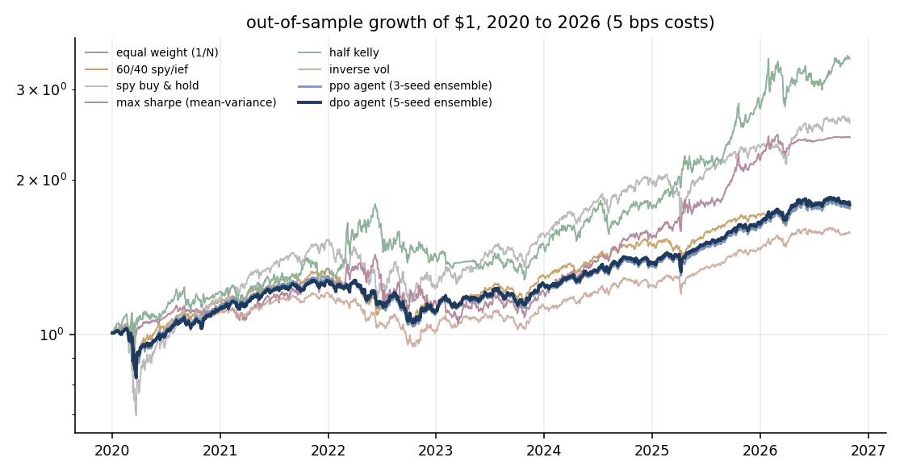
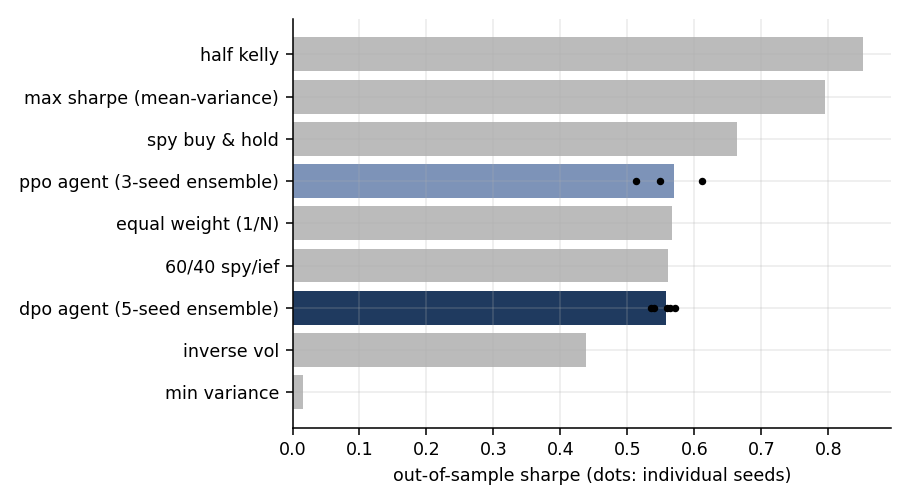
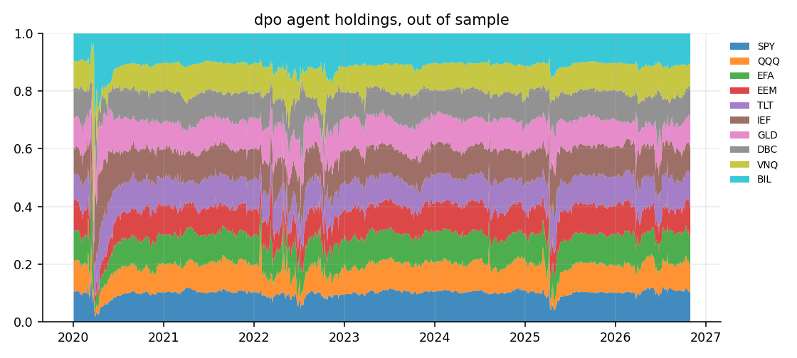
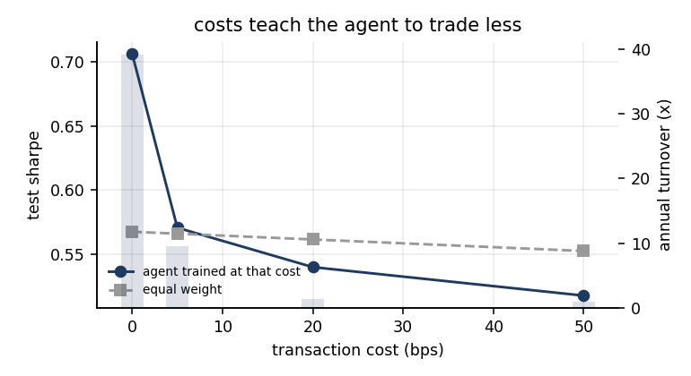
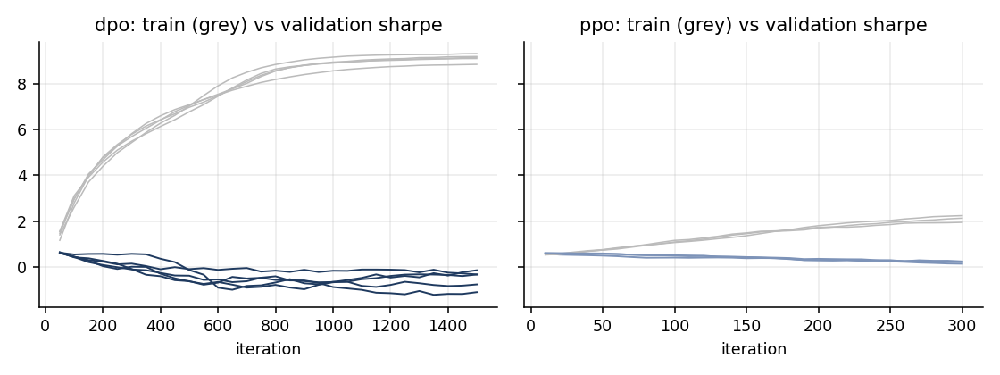
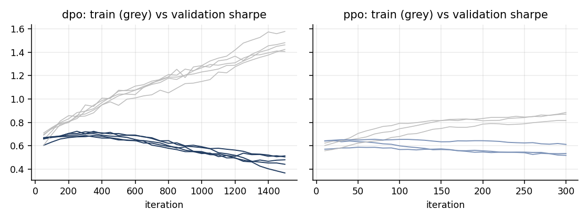

# Reinforcement learning for continuous portfolio optimization

This project trains a reinforcement learning agent to rebalance a 10-asset ETF portfolio every day, and benchmarks it with transaction costs against the classical strategies it is supposed to beat: mean-variance, Kelly, risk parity, 1/N and 60/40.

**Short version:** under realistic costs, both RL agents land within 0.01 Sharpe of equal weighting out of sample. They *do* find signal: before costs the agent reaches a 0.71 Sharpe against 0.57 for 1/N. But exploiting that signal takes heavy trading, and 5 bps of costs is enough to erase it. The rest of this README covers how I got there, including two versions that failed.



## Setup

| | |
|---|---|
| universe | SPY, QQQ, EFA, EEM, TLT, IEF, GLD, DBC, VNQ, and BIL (t-bills, used as cash and as the risk-free rate) |
| data | daily adjusted closes, May 2007 – Oct 2026 (yfinance) |
| splits | train 2007–2017 · validation 2018–2019 · **test 2020 – Oct 2026**, untouched until the end |
| costs | 5 bps per unit of one-way turnover, on every strategy |
| decision | at each close, choose long-only weights on the simplex for the next day |

**Agents.** Both share one policy architecture, following EIIE ([Jiang, Xu & Liang, 2017](https://arxiv.org/abs/1706.10059)). A tiny network scores each asset independently from its own signals and its current weight, and a softmax across assets turns the scores into weights. Sharing the scorer across assets keeps it at 130 parameters.

- **DPO (direct policy optimisation):** the market step is differentiable in the weights, so the policy is trained by backpropagating a risk-adjusted log return, net of costs, through 64-day rollouts. This is a deterministic policy gradient through a known transition model.
- **PPO:** the model-free route. The same scorer parameterises a Dirichlet distribution over the simplex, trained with clipped PPO and GAE, and the market is treated as a black box.

Both early-stop on validation Sharpe. Hyperparameters (risk aversion × training-cost multiplier) are chosen on validation only. The test numbers come from ensembles that average the target weights across seeds: 5 seeds for DPO, 3 for PPO.

**Baselines** refit on a trailing 252-day window and rebalance monthly. Covariances are shrunk 30% toward the diagonal, and means are shrunk halfway toward the cross-sectional average.

## Results (test, 2020 – Oct 2026)

| strategy | cagr | vol | sharpe | sortino | max dd | turnover/yr |
|---|---|---|---|---|---|---|
| half kelly | 19.9% | 20.7% | 0.85 | 1.18 | -28.8% | 5.7x |
| max sharpe (mean-variance) | 13.9% | 14.2% | 0.80 | 1.10 | -26.6% | 4.9x |
| spy buy & hold | 14.9% | 20.0% | 0.66 | 0.93 | -33.7% | 0.0x |
| ppo agent (3-seed ensemble) | 8.6% | 10.9% | 0.57 | 0.78 | -19.6% | 6.5x |
| equal weight (1/N) | 8.8% | 11.2% | 0.57 | 0.78 | -19.6% | 0.3x |
| 60/40 spy/ief | 9.1% | 12.0% | 0.56 | 0.79 | -21.3% | 0.2x |
| **dpo agent (5-seed ensemble)** | 8.9% | 11.7% | 0.56 | 0.78 | -19.9% | 9.0x |
| inverse vol | 6.9% | 10.3% | 0.44 | 0.60 | -21.6% | 0.4x |
| min variance (risky assets) | 2.6% | 6.6% | 0.02 | 0.02 | -18.8% | 0.8x |

Per-seed test Sharpe: DPO 0.55 ± 0.01, PPO 0.56 ± 0.04.



### What I take from it

1. **The agent learns a tilted 1/N, not nothing.** Its holdings move with the market regime. It rotated into Treasuries and t-bills in March 2020, cut equities through the 2022 drawdown, and de-risked again in April 2025. Those tilts are real, but out of sample they are worth about as much as they cost to trade.

   

2. **Costs decide everything.** Retraining the agent at different cost levels shows a clean frontier. With free trading it turns the book over 39× a year and earns a 0.71 Sharpe, versus 0.57 for 1/N. At 5 bps it learns to trade 4× less, and the edge goes with it.

   | cost (bps) | agent sharpe | agent turnover | 1/N sharpe |
   |---|---|---|---|
   | 0 | 0.71 | 39.2x | 0.57 |
   | 5 | 0.57 | 9.5x | 0.57 |
   | 20 | 0.54 | 1.3x | 0.56 |
   | 50 | 0.52 | 0.9x | 0.55 |

   

3. **Picking strategies on validation would have been wrong anyway.** On 2018–19, min variance was the best baseline (Sharpe 0.97), and max-Sharpe and half-Kelly were the worst (−0.07 and −0.23). On 2020–26 that order flips almost exactly: half-Kelly's 0.85 comes from concentrating in QQQ during a tech bull run. Rankings are regime-dependent, and 1/N's robustness is the point of [DeMiguel, Garlappi & Uppal (2009)](https://doi.org/10.1093/rfs/hhm075).

## Development log

Each version is kept in `results/`.

**v1: raw 60-day windows, no cost shaping** (`results/v1`). The DPO agent turned the portfolio over 175× a year. Before costs it had a 0.84 test Sharpe, but costs left it at 0.31, the worst of the field. Also, the min-variance baseline silently returned its initial guess (exactly 1/N): daily covariances (~1e-5) were below SLSQP's tolerance. I fixed that by annualising, and restricted min variance to the risky assets, since otherwise it trivially goes to 100% t-bills.

**v2: training-cost multiplier** (`results/v2`). Inflating costs during training only (×1/×4/×10, chosen on validation) cut turnover to 6×. But the learning curves showed the real problem. Train Sharpe climbed to ~9 while validation fell from the first evaluation, so early stopping just returned the untrained, near-uniform policy. With 2.5k parameters on raw return windows, the network memorised 2007–2017.



**v3: compact features + weight decay** (current). Each asset is now described by six numbers: momentum over 5/20/60 days, volatility over 20/60 days, and momentum relative to the cross-section. The policy shrinks to 130 parameters, trained with AdamW. Training and validation now improve together for the first ~300 iterations before diverging, and early stopping catches the peak.



## Next

- Weekly or threshold-based rebalancing as an action constraint, instead of only penalising daily turnover.
- Macro and sentiment state (rates, curve slope, credit spreads), which the proposal called for and this version leaves out.
- Walk-forward retraining instead of a single 2017 cut-off.
- A Kelly-style objective with uncertainty in the mean estimate, since that is where the classical strategy that won the test period breaks.

## Reproduce

```bash
python -m venv .venv && .venv/bin/pip install -r requirements.txt
.venv/bin/python -c "from rlpo.data import download; download()"   # optional: refresh prices
.venv/bin/python run.py                                             # ~10 min on a laptop CPU
```

`run.py` rewrites `results/` and `figures/`. All randomness is seeded.
